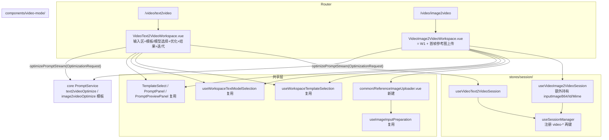
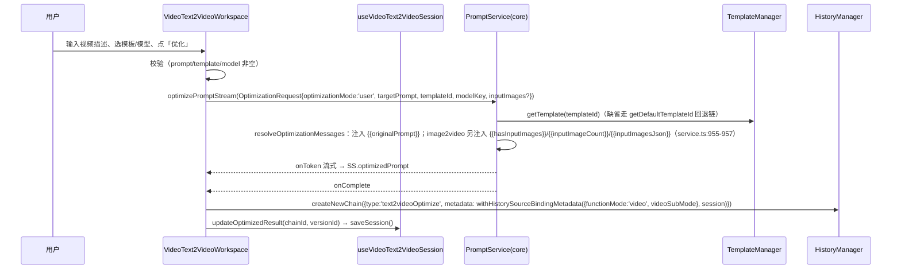

# 视频提示词前端（Video Prompt Frontend）增量实现设计

> 作者：架构师高见远（software-architect）｜ 2026-10-19
> 前置：阶段 1 后端已完成并验证（提交 71c70d77）：视频模板、服务回退链、PromptRecordType 均已就绪。
> 本文档为「视频提示词」功能域在 UI 层的接入设计，不含任何已写代码；所有行号为 2026-10-19 快照。

---

## 1. 实现方案概述

### 1.1 核心决策

| # | 决策 | 结论 |
|---|------|------|
| D1 | 工作区组件 | **精简新写** `components/video-mode/`，不改造 image 工作区 |
| D2 | FunctionMode 'video' 接入 | core 与 ui 两层类型面同步扩展，逐点接入（见 §3 清单） |
| D3 | image2video 首帧上传 | **复用** image 系上传/压缩/存储逻辑，抽取共享上传组件 |
| D4 | 收藏/历史兼容 | 全部枚举为**追加式 union 扩展**，旧数据解析路径零改动；新写入路径补守卫 |
| D5 | 构建顺序 | `core build` → `ui typecheck/build`（ui 依赖 core dist） |

### 1.2 D1 依据：为什么精简新写而不是改造复用

实测组件规模：`ImageText2ImageWorkspace.vue` 3287 行、`ImageImage2ImageWorkspace.vue` 2786 行、`ImageMultiImageWorkspace.vue` 2212 行。其复杂度构成：

- **图像生成测试区**（variants deck a/b/c/d、图像模型生成、对比模式、评估面板、ImageTokenUsage）——服务"真的要调图像模型出图"的场景；
- 参考图复刻/风格学习（referenceImage 提取变量）、多图排序管理、garden 导入等图像专属能力。

视频域阶段目标：**输入视频描述 → 选模板优化 → 输出结构化视频提示词（文本）**，不调用视频生成 API。image 工作区约 60% 代码（测试区/评估/变体）对视频无用，挖空改造的回归风险高于新写。

新写采用"**厚 composables + 薄组件**"：直接复用既有原子组件与 composable（不重复造轮子）：

- UI 原子件：`PromptPanel.vue`、`PromptPreviewPanel.vue`、`SelectWithConfig.vue`、`TextModelQuickSwitch.vue`、`FullscreenDialog.vue`、`AppPreviewImage.vue`、`WorkspaceUtilityMenu.vue`、`VariableAwareInput`（variable-extraction）
- 逻辑 composable：`useWorkspaceTemplateSelection`、`useWorkspaceTextModelSelection`、`useImageInputPreparation`（含 `utils/image-compression` 压缩链）、`useLocalPromptPreviewPanel`、`useFullscreen`、`useToast`、`withHistorySourceBindingMetadata`
- 存储：`image-asset-storage.ts` 的 `persistImagePayloadAsAssetId/normalizeImageSourceToPayload`、`imageStorageMaintenance.ts` 的 `computeStableImageId/queueImageStorageMaintenance/scheduleImageStorageGc`

### 1.3 组件结构图



### 1.4 子模式键与路由

| 项 | 值 |
|---|---|
| SubModeKey | `video-text2video`、`video-image2video` |
| 路由 | `/video/text2video`、`/video/image2video` |
| FunctionMode | `'video'`（core + ui 双处定义同步扩） |
| 模板 templateType | `text2videoOptimize`（id `video-general-optimize`）、`image2videoOptimize`（id `video-image-optimize`） |
| 历史记录类型 | `text2videoOptimize` / `image2videoOptimize`（core 已就绪） |
| 收藏 functionMode | `'video'` + 新字段 `videoSubMode?: 'text2video' \| 'image2video'` |

> 关于 PromptContract：新增 `VideoPromptContract`（family `'video'`，subMode/modeKey 同上表）。`PromptContent` 不新增 kind——视频优化输出为纯文本，复用 `'text'`；首帧图放在 `OptimizationRequest.inputImages`（既有字段，service.ts:955-957 已注入 `{{hasInputImages}}/{{inputImageCount}}/{{inputImagesJson}}`，与 image2video 模板变量契约对齐）。

---

## 2. 文件清单

### 2.1 修改（core，先做，`pnpm -F @prompt-optimizer/core build` 后 ui 才能过编译）

| 文件（packages/core/src/…） | 职责 |
|---|---|
| `services/prompt/types.ts` L67 | `FunctionMode` 加 `'video'`；新增 `VideoSubMode = 'text2video' \| 'image2video'` |
| `services/prompt-model/types.ts` | `PromptModeKey` 加 `video-text2video/video-image2video`；`PromptModeFamily` 加 `'video'`；新增 `VideoPromptContract` 并入 `PromptContract` 联合 |
| `services/prompt-model/mode.ts` | `PROMPT_MODE_KEYS` 追加两键；`FavoriteModeCompat` 加 `'video'` + `videoSubMode`；`resolvePromptModeKey` 加 `functionMode==='video'` 分支；`promptModeKeyToFavoriteMode` 加两个 case；`createPromptContract` 加两个 case |
| `services/prompt-model/session.ts` L23-31 | `LEGACY_SESSION_SUB_MODE_KEYS` 追加 `video-text2video`、`video-image2video` |
| `services/favorite/types.ts` L26/L30 | `FavoritePrompt.functionMode` 加 `'video'`；新增 `videoSubMode?: 'text2video' \| 'image2video'` |
| `services/favorite/type-mapper.ts` | `FunctionModeMapping` 加 `'video'`；`mapFromRecordType` 加 `text2videoOptimize/image2videoOptimize` 分支；`validateMapping` 加 video 校验；`inferRecordTypes` 加 video 反查 |
| `services/favorite/storage-guards.ts` L17-30 | 新增 `isVideoSubMode` 守卫；`isFunctionMode` 加 `'video'`；`normalizeFavoriteRecord` 处理 `videoSubMode`（video 模式清空 optimizationMode/imageSubMode） |

### 2.2 修改（ui 基础设施）

| 文件（packages/ui/src/…） | 职责 |
|---|---|
| `router/workspaceRoutes.ts` | `WORKSPACE_SUB_MODES` 加 `video: ['text2video','image2video']`；`WORKSPACE_SUB_MODE_KEYS` 加两键；`parseWorkspaceRoutePath` 正则 `^(basic|pro|image|video)`；`getDefaultSubModeForWorkspaceMode` video→text2video |
| `router/index.ts` | 新增 `/video/text2video`、`/video/image2video` 两条懒加载路由 |
| `router/guards.ts` L38 | 非法子模式重定向正则加入 `video` |
| `stores/session/sessionKeys.ts` | `SESSION_SUB_MODE_KEYS`、`SESSION_STORAGE_KEYS` 加两键（`Record` 完整性会让漏改直接编译报错） |
| `stores/session/useSessionManager.ts` | `getActiveSubModeKey`/`computeSubModeKey` 加 `case 'video'`（L164/L193）；`sessionStores` 注册两个 video store（L208-210 附近）；`saveSubModeSession`/`restoreSubModeSession` switch 加两个 case（L317/L375 附近） |
| `stores/settings/useGlobalSettings.ts` | 本地 `FunctionMode` 加 `'video'`；`isFunctionMode` 守卫加 `'video'`；state 加 `videoSubMode` + `updateVideoSubMode`；持久化 restore/save 兼容 |
| `composables/mode/useFunctionMode.ts` | 本地 `FunctionMode` 加 `'video'`；`switchToVideo`；L46 白名单加 `'video'` |
| `composables/mode/useCurrentMode.ts` / `useImageSubMode.ts` 同型 | 新增 `useVideoSubMode`（新文件，见 2.3） |
| `components/app-layout/AppSidebar.vue` L235-256 | `workspaceSections` 追加「视频模式」分组：`/video/text2video`（🎬）、`/video/image2video`（🎞️） |
| `components/app-layout/PromptOptimizerApp.vue` | ① `parseRouteInfo`（L472-474、L543-547）加 video 分支；② `currentPageTitle`（L490-501）加两条映射；③ 路由同步 watch（L602 附近）加 `updateVideoSubMode`；④ 所有 `routeFunctionMode==='image'` 式三分链补 video（L1125-1147、L1327-1336、L1651-1653、L1867-1878、L1981-1988 等处，指向 video session）；⑤ `templateManagerState.currentType` 按 video 子模式给出 `text2videoOptimize/image2videoOptimize` |
| `composables/app/useAppHistoryRestore.ts` L134-197 | 在 image 分支并列处新增 video 分支：`rt === 'text2videoOptimize'|'image2videoOptimize'` → `navigateToSubModeKey('video-…')` → `window.dispatchEvent(new CustomEvent('video-workspace-restore', …))`（仿 image 的 `image-workspace-restore` 事件机制，L187-193） |
| `composables/app/useAppFavorite.ts` L375-390 | `currentFunctionMode` 推导加 `'video'`；`getSessionForCurrentMode`/`getAssetBindingSessionForMode` 加 video 分支返回对应 session；prefill 携带 `videoSubMode` |
| `utils/favorite-mode.ts` | `NormalizedFavoriteFunctionMode` 加 `'video'`；normalize 加 `if (mode === 'video') return 'video'` |
| `components/SaveFavoriteDialog.vue` L91 | `currentFunctionMode` prop 联合加 `'video'` |
| `components/FavoriteEditorForm.vue` L449/L1425 | prop 联合加 `'video'`；functionMode 分支链补 video（携带 videoSubMode） |
| `components/HistoryDrawer.vue` L88-107/L394-418 | 加 `text2videoOptimize`/`image2videoOptimize` 的 NTag 与 `getFunctionModeLabel`/`getFunctionModeTagType` video 归类 |
| `components/favorites/FavoritesPage.vue` L48-75 | `FavoriteInitialModeFilter` 加 `video-text2video/video-image2video`；`resolveInitialModeFilter` 加 video 分支 |
| `components/TemplateManager.vue` L677-688/L753-810 | props `templateType` 联合加两个 video 类型；`getCategoryFromProps`/`getCurrentTemplateType` 加 `video-text2video-optimize`→`text2videoOptimize`、`video-image2video-optimize`→`image2videoOptimize`；分类页签加视频组 |
| `components/TemplateSelect.vue` L53 | validator 数组加 `'text2videoOptimize'`、`'image2videoOptimize'` |
| `i18n/locales/{zh-CN,en-US,zh-TW}/index.ts` | 各自 `import video from './video'` 并展开 |
| `i18n/locales/{zh-CN,en-US,zh-TW}/image.ts` 的映射目标（`nav.imageMode` 所在 core.ts） | `nav` 段加 `videoMode: '视频模式'` 等键（三语，`check:locale` 会校验结构对齐） |

### 2.3 新建（ui）

| 文件（packages/ui/src/…） | 职责 |
|---|---|
| `components/video-mode/VideoText2VideoWorkspace.vue` | 文生视频工作区：输入区 + 模板/文本模型选择 + 优化/迭代（流式） + 结果预览 + 全屏编辑 + 临时变量 + 历史恢复事件监听。目标 ≤1000 行 |
| `components/video-mode/VideoImage2VideoWorkspace.vue` | 图生视频工作区 = 文生视频 + 首帧参考图上传区（缩略图/删除，复用 AppPreviewImage）。目标 ≤1200 行 |
| `components/common/ReferenceImageUploader.vue` | 共享首帧上传小组件：按钮 + 隐藏 input + 压缩确认 + v-model(ImageInputRef)。从 image2image 内联实现（ImageImage2ImageWorkspace L172-227 + 上传 Modal）抽象，但**不回改** image2image（避免回归） |
| `stores/session/useVideoText2VideoSession.ts` | 会话状态 + 持久化（preferenceService，key 走 SESSION_STORAGE_KEYS），仿 useBasicUserSession 的精简形态（无需图像 variants/evaluations） |
| `stores/session/useVideoImage2VideoSession.ts` | 同上 + `inputImageB64/Id/Mime`；持久化时 `persistImagePayloadAsAssetId` 落 ImageStorageService、GC 挂 `scheduleImageStorageGc`（完全复用 image2image session 的输入图管线） |
| `composables/mode/useVideoSubMode.ts` | 仿 useImageSubMode：读写 globalSettings.videoSubMode |
| `i18n/locales/zh-CN/video.ts`、`en-US/video.ts`、`zh-TW/video.ts` | 视频域翻译：`videoMode.*`、`videoWorkspace.input.*/upload.*/result.*`；三语键结构必须一致（`scripts/check-locale-parity.mjs` 强校验） |

### 2.4 不动的文件（明确排除）

- `packages/core` 的模板文件、`service.ts`、`history/types.ts`（阶段 1 已完成）
- `ImageText2ImageWorkspace.vue` / `ImageImage2ImageWorkspace.vue` / `ImageMultiImageWorkspace.vue`（零改动）
- `FavoriteButton.vue`（默认 `functionMode:'basic'` 的兜底对新链路无影响，收藏模式由 useAppFavorite prefill 决定）

---

## 3. 数据流 / 调用流程

### 3.1 优化主链路（文生视频；图生视频多一步上传）



要点：
- 请求构造与 `ImageImage2ImageWorkspace.vue:2335-2362` 同构；**image2video 在 `inputImages` 传 `[ {b64, mimeType} ]`，text2video 不传**（`hasInputImages=false`，模板变量得到 `[]`/0）。
- 模板回退链已就绪：`text2videoOptimize→[text2imageOptimize,userOptimize,optimize]`；`image2videoOptimize→[text2videoOptimize,…]`（service.ts:1079-1082），无需后端改动。
- 迭代走 `iteratePromptStream` + `historyManager.addIteration`（同 image 工作区形态，无视频专用 iterate 模板，回退到通用 iterate）。

### 3.2 历史恢复链路

`HistoryDrawer 点「使用」→ useAppHistoryRestore.handleHistoryReuse → rt∈{text2videoOptimize,image2videoOptimize} 新分支 → navigateToSubModeKey('video-…') → nextTick → dispatch 'video-workspace-restore' {originalPrompt, optimizedPrompt, chainId, versions, templateId, imageMode?} → 视频工作区 onMounted 监听回填 → persistRestoredSession`。

### 3.3 收藏链路

结果区收藏 → `useAppFavorite`（`getCurrentFunctionMode()==='video'` → prefill `functionMode:'video', videoSubMode` → 绑定对应 video session 的 assetBinding）→ `SaveFavoriteDialog` → core `FavoriteManager`（`normalizeFavoriteRecord` 新守卫放行 video）→ `FavoritesPage/FavoriteLibraryWorkspace` 按 `video-text2video/video-image2video` 筛选 → 「使用」回填对应工作区。

### 3.4 旧数据不受影响的保证（D4）

1. **只加不删**：所有 union（FunctionMode/PromptModeKey/PromptRecordType/favorite functionMode）均为追加成员；旧记录、旧收藏的解析分支一条不动。
2. 新写入路径必须补齐守卫，否则**新**收藏刷新后会被降级为 basic：`storage-guards.isFunctionMode` 不加 `'video'` 时 `normalizeFavoriteRecord` 会把新 video 收藏静默降级（L193-195）——这是最关键的兼容点，单测覆盖：旧 fixture（basic/context/image）round-trip 逐字节等价 + 新 video fixture round-trip。
3. session 持久化键隔离：`session/v1/video-*` 为全新 key，不触碰既有 7 个 key。
4. `useGlobalSettings` restore：旧持久化值不含 `'video'`，`isFunctionMode` 扩展后仍按白名单放行，默认行为不变。
5. 路由兜底：`parseWorkspaceRoutePath` 不识别的旧路径走既有 fallback，不进 video。

---

## 4. 有序任务列表（粒度 = 一个工程师一个 turn）

> 依赖用 ← 表示。每项含验收标准。

| # | 任务 | 内容 | 依赖 | 验收 |
|---|------|------|------|------|
| T1 | core 类型面扩展 | §2.1 前 4 个文件（prompt/types、prompt-model/types、mode.ts、session.ts） | — | `pnpm -F @prompt-optimizer/core build` 通过；`promptModeKeyToFavoriteMode('video-image2video')`、`createPromptContract`、`resolvePromptModeKey({functionMode:'video',videoSubMode})` 单测通过 |
| T2 | core 收藏兼容 | §2.1 favorite 三文件 | T1 | favorite 单测：旧数据 round-trip 不变 + video 收藏 normalize/validate 通过；`TypeMapper.mapFromRecordType('text2videoOptimize')` 正确 |
| T3 | ui 路由与模式骨架 | workspaceRoutes、router/index、guards、sessionKeys、useGlobalSettings、useFunctionMode、useVideoSubMode、AppSidebar 分组、currentPageTitle | T1 | `pnpm -F @prompt-optimizer/core build` 后 ui typecheck 通过；侧边栏出现视频分组可导航（页面暂 404 组件占位）；非法路径 `/video/xxx` 重定向 `/video/text2video` |
| T4 | 三语 i18n | 三个 `video.ts` + index 注册 + nav 键 | T3（并行可） | `pnpm check:locale` 通过；`check:no-chinese-runtime` 不回退 |
| T5 | video session stores | 两个 session store + useSessionManager 注册/保存/恢复 | T3 | 切换 `/video/text2video`↔`/video/image2video`↔basic 会话各自隔离；刷新后草稿与首帧图恢复 |
| T6 | 共享上传组件 | `common/ReferenceImageUploader.vue`（复用 useImageInputPreparation） | T3 | 组件单测/手测：选择→压缩确认→ImageInputRef 输出；超限报错文案 i18n |
| T7 | 文生视频工作区 | `VideoText2VideoWorkspace.vue` 全功能（§2.3 首行） | T5 | 输入→优化→流式输出→历史链生成 type='text2videoOptimize'；迭代可用；无模板/模型时错误 toast |
| T8 | 图生视频工作区 | `VideoImage2VideoWorkspace.vue` = T7 + 首帧上传 | T6, T7 | 未传首帧时优化被拦截；请求 inputImages 正确；模板变量 `hasInputImages=true` 生效（观察输出结构含首帧描述段） |
| T9 | App 接线 + 历史恢复 | PromptOptimizerApp 各分发点（§2.2 第 11 行）+ useAppHistoryRestore video 分支 + `video-workspace-restore` | T7, T8 | 从历史「使用」video 记录自动跳 `/video/*` 并回填；image/basic 历史恢复回归正常 |
| T10 | 模板管理接入 | TemplateManager、TemplateSelect、App 的 templateManagerState.currentType | T7 | 视频工作区打开模板管理显示视频模板组；可选中新模板；模板 CRUD 落 localStorage 正常 |
| T11 | 收藏链路 | useAppFavorite、SaveFavoriteDialog、FavoriteEditorForm、favorite-mode、FavoriteDetailPanel、FavoritesPage 筛选、（不动 FavoriteButton） | T5 | video 结果可收藏→筛选可见→「使用」回填工作区；刷新后收藏不降级 |
| T12 | HistoryDrawer 标签 | video 记录类型 NTag + label 归类 | T9 | video 链显示「视频模式」标签，点使用不误入 basic 分支 |
| T13 | 全量校验与回归 | root `pnpm check:locale`、`pnpm test:repo`、ui build、手测清单（三语切换/收藏/历史/模板/刷新恢复/双端 web+desktop） | T9-T12 | 全绿；手工冒烟清单逐项打勾 |
| T14 | 文档收尾（可选） | `docs/` 增补 video-mode.md、CHANGELOG | T13 | 合并 |

**关键顺序约束**：T1 必须最先且完成后立即 `build:core`，否则 ui 所有涉 video 类型的编辑无法通过编译（ui 从 `@prompt-optimizer/core` 导入 FunctionMode/SubModeKey）。

---

## 5. 风险与待明确事项

| # | 风险/事项 | 说明 | 缓解 |
|---|----------|------|------|
| R1 | `PromptOptimizerApp.vue` 分发点遗漏 | 该文件 2487 行，`routeFunctionMode` 三分链至少 10 处（§2.2 列出实测行号），漏一处表现为"video 页面下某全局功能静默不工作"而非报错 | T9 用 grep `routeFunctionMode` 全量核对；冒烟清单覆盖每个全局入口（模板/收藏/历史/变量/预览） |
| R2 | useFunctionMode/useGlobalSettings 双源 FunctionMode | ui 两处本地重复定义 core 的 FunctionMode，本阶段各加一次 `'video'`；不强制合并（避免波及），留待后续重构 | 任务内加 TODO 注释标注双源 |
| R3 | legacy session registry 兼容 | `promptModeKeyToLegacySessionSubModeKey`（session.ts L142）对 video-* 的映射行为需在 T1 单测确认（应恒等返回） | 单测断言 |
| R4 | 收藏条目体积 | 首帧图以 ImageRef(assetId) 形式存 session，不进收藏 payload；收藏只存文本 | `assertFavoriteMetadataHasNoInlineImages` 既有守卫继续生效 |
| R5 | FavoritesPage/FavoriteLibraryWorkspace 筛选入口 | 筛选 UI 的模式选项列表可能在 FavoriteLibraryWorkspace 内另有一份（FavoritesPage 只传 initial filter） | T11 时 grep `image-multiimage` 全 ui 核对筛选选项清单 |
| R6 | e2e 用例 | `tests/`、`playwright.config.ts` 已有 image 组，video 组是否本阶段补 e2e 未明确 | 先以手测冒烟交付，e2e 列 follow-up |
| R7 | zh-TW 文案 | 视频域繁体文案需人工把关术语（首帧/图生视频） | T4 由团队 review |
| Q1 | 迭代模板 | 视频无专用 iterate 模板，回退通用 `iterate`；产品上是否需要 `videoIterate` 记录类型/模板 | 待产品确认；当前设计按"无专用迭代、记录类型沿用 imageIterate 式扩展可后续追加"处理（T7 中迭代记录 type 暂用 `imageIterate` 不合适——**暂以 'iterate' 落历史并 metadata.functionMode='video'**，待 Q1 明确后调整） |
| Q2 | 多帧/尾帧参考图 | 当前 image2video 模板契约只注入首帧清单（单图 enough）；是否支持尾帧待产品 | 模板变量 `inputImagesJson` 已支持多图，UI 先限 1 张 |

---

## 6. 附：i18n 键草案（zh-CN/video.ts）

```ts
export default {
  videoMode: {
    text2video: '文生视频',
    image2video: '图生视频',
    text2videoDescription: '从文本描述生成视频提示词',
    image2videoDescription: '基于首帧参考图生成视频提示词',
    uploadRequired: '图生视频模式需要先上传首帧参考图',
  },
  videoWorkspace: {
    input: {
      originalPrompt: '视频描述',
      originalPromptPlaceholder: '请描述你想生成的视频内容（镜头、场景、动作、氛围…）',
      selectImage: '📁 选择首帧',
      removeImage: '移除首帧',
      optimizePrompt: '优化提示词',
      optimizing: '优化中...',
      optimizeTemplate: '优化模板',
      textModel: '文本模型',
    },
    // result/iterate 等键与 imageWorkspace 同构
  },
}
```

`nav.videoMode`、`toast.info.switchedToVideoMode`、`toast.success.videoHistoryRestored` 等散键加在对应既有段（core.ts / prompt.ts / errors.ts 三语同步）。
